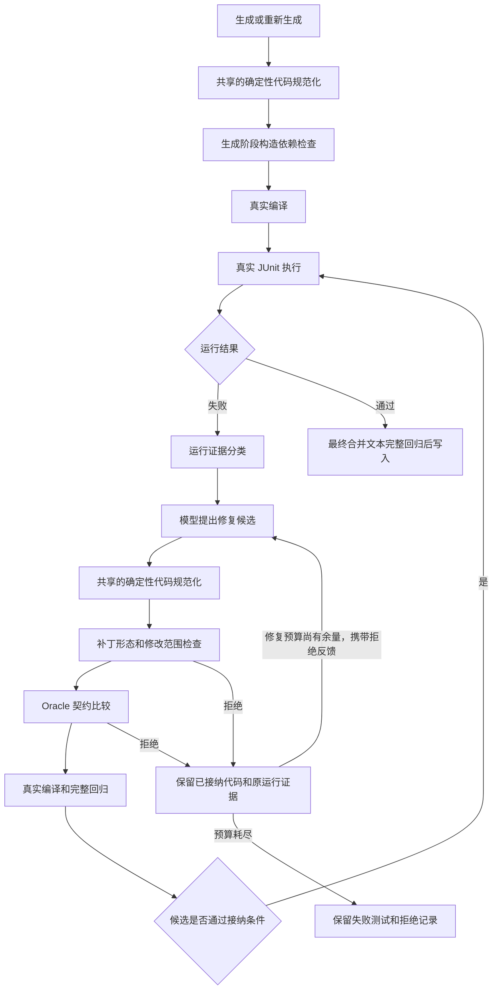

# UnitMind

UnitMind 是一个 IntelliJ IDEA 插件，用于在 Java 项目中为当前光标所在方法，或为当前顶层具体类生成 JUnit 5 + Mockito 单元测试。插件提供编辑器右键入口和右侧 Tool Window，按步骤展示静态分析、测试场景、Mock 策略、测试代码和写入结果。

## 功能概览

- 在 Java 文件中右键选择 `UnitMind：生成单元测试`，自动打开右侧 `UnitMind` 面板。
- 自动定位当前光标所在方法，优先分析该方法；无法定位时退回到文件中的 public 方法或首个方法。
- 方法概要和参数约束只使用 JavaParser 静态分析，不调用大模型，不发 HTTP 请求。
- 测试场景、Mock 策略和测试代码在后续步骤按需生成；当前测试场景由规则规划，大模型主要增强 Mock 策略和测试代码。
- 生成的测试代码可在插件面板中编辑、复制、再次生成，并写入项目测试目录。
- 写入已有测试类时支持追加、覆盖，并用方法级或类级 UnitMind region 管理旧生成代码。

## 技术栈

- IntelliJ Platform Plugin SDK
- Gradle Kotlin DSL
- Java 17
- JavaParser 3.25.10
- OkHttp 4.9.0
- org.json
- JUnit 5 + Mockito 代码生成模板

目标 IDE 平台配置在 [build.gradle.kts](build.gradle.kts)：

- IntelliJ IDEA Community `2022.2.5`
- 插件兼容范围 `222` 到 `262.*`（IntelliJ IDEA 2022.2 至 2026.2）
- 插件名称 `UnitMind`

## 项目结构

```text
src/main/java/com/casc/unittestagent
├── action       # 编辑器右键动作
├── generator    # 测试场景、Mock 策略、测试代码生成
├── llm          # 大模型配置、Prompt、HTTP 客户端、响应解析
├── model        # 方法、参数、约束、场景、Mock、生成结果等数据模型
├── parser       # JavaParser 静态分析
├── service      # 生成流程编排
├── toolwindow   # UnitMind 右侧工具窗口
├── ui           # 设置弹窗、写入弹窗、步骤页和组件
├── util         # PSI 与字符串工具
└── writer       # 测试文件落盘与合并
```

插件入口注册在 [plugin.xml](src/main/resources/META-INF/plugin.xml)，包含：

- Tool Window：`UnitMind`
- 编辑器右键菜单：`UnitMind：生成单元测试`
- 编辑器右键菜单：`UnitMind：测试数据生成配置`

> 当前前端只开放单方法生成入口。整类生成保留在服务层与评测链路中（`ClassUnitTestGenerationService` 及其测试），未注册编辑器菜单；需要重新开放时在 plugin.xml 恢复 `GenerateClassUnitTestAction` 注册即可。

## 核心流程

### 1. 右键入口

单方法入口保持原有行为。整类生成能力保留在服务与评测链路（只支持顶层、非抽象普通类，默认纳入 public、protected、package-private 和 static 业务方法，并明确展示 private、getter/setter 和 Object 基础方法的跳过原因），但前端暂不开放入口。

整类模式按方法顺序调用大模型。每个方法候选会先独立编译并按诊断修复，然后作为一次事务加入当前已通过的 `<ClassName>Test`：每次 AST 聚合后都立即执行完整类编译门禁，通过后才成为下一个方法的基线。候选冲突、合并后不能编译或输出不符合类模式契约时，仅回退当前方法；规则草稿仍不能通过时剔除当前方法并回滚到上一可编译检查点，不把多组错误堆积到最终统一修复。常见的候选级 `@BeforeEach` 会被转换成只服务于本候选测试的 setup helper，避免污染其他方法。首期不在整类模式执行类级 JaCoCo 闭环，单方法覆盖率功能不变。

[GenerateUnitTestMvpAction.java](src/main/java/com/casc/unittestagent/action/GenerateUnitTestMvpAction.java) 负责：

- 校验当前项目、编辑器和 PSI 文件。
- 只在 Java 文件中展示菜单。
- 打开右侧 `UnitMind` Tool Window。
- 将当前 `Editor` 和 `PsiFile` 传给面板，并立即触发静态分析。

### 2. Tool Window 状态编排

[UnitMindToolWindowPanel.java](src/main/java/com/casc/unittestagent/toolwindow/UnitMindToolWindowPanel.java) 是主 UI 编排类，负责：

- 保存当前编辑器上下文。
- 管理五个步骤的状态。
- 触发后台分析任务。
- 切换步骤。
- 写入测试文件。

五个步骤为：

1. 静态分析结果（方法或类概要、纳入/跳过方法）
2. 测试场景
3. Mock 策略
4. 测试代码
5. 写入测试文件

线程模型：

- 右键自动分析和“重新分析”使用 `Task.Backgroundable` 后台任务。
- 后台任务完成后再回到 UI 线程刷新面板。
- 避免在 Swing EDT 上执行 JavaParser、文件分析、网络请求或大模型调用。

## 生成阶段划分

当前实现刻意把“静态分析”和“后续生成”拆成两个阶段，避免打开面板或重新分析时卡住 IDE。

### 阶段一：静态分析

入口方法：

- `UnitTestGenerationService.analyzeMethod(...)`

职责：

- 读取当前 Java 源码文本。
- 通过 PSI 获取当前光标所在方法名。
- 使用 JavaParser 解析源码。
- 构建 `MethodModel`。
- 提取方法概要、参数、返回值、throws、import、方法体、约束、分支、依赖调用等信息。
- 使用 `TestDataGenerator` 为参数补充候选测试数据。

相关实现：

- [UnitTestGenerationService.java](src/main/java/com/casc/unittestagent/service/UnitTestGenerationService.java)
- [JavaSourceAnalyzer.java](src/main/java/com/casc/unittestagent/parser/JavaSourceAnalyzer.java)
- [ConstraintExtractor.java](src/main/java/com/casc/unittestagent/parser/ConstraintExtractor.java)
- [DependencyExtractor.java](src/main/java/com/casc/unittestagent/parser/DependencyExtractor.java)

### 阶段二：场景、Mock 和测试代码生成

入口方法：

- `UnitTestGenerationService.generateArtifacts(...)`

触发时机：

- 用户进入 `测试场景` 及后续步骤时才按需触发。

职责：

- 根据 `MethodModel` 使用规则规划测试场景。
- 根据依赖和场景使用规则规划 Mock 策略。
- 先生成一份规则兜底测试代码。
- 如果启用了大模型，则把静态分析上下文、规则场景和规则 Mock 信息发送给大模型，生成更完整的 Mock 策略和测试代码。
- 如果大模型失败，根据配置决定是否回退到规则生成代码。
- 使用 IntelliJ PSI 构建真实项目符号快照，向大模型提供实际构造函数、方法签名、重载、返回类型和可见性。
- 生成后使用当前模块 SDK、依赖和源码路径执行隔离编译；编译修复轮次可配置，且诊断数增加或引入不可修错误的恶化候选会自动回滚。
- 覆盖率运行修复使用失败测试方法级补丁，不让模型重写整类；同一次 JUnit 执行的多个独立失败会一并反馈。
- 修复响应中的 `diagnosis` / `edits` 会被解析和记录；仅改断言消息等不改变运行失败签名的候选会被识别为无进展并回滚。
- 正常写入会先独立执行并分类修复候选测试，再对最终合并文本重新编译、执行完整 JUnit 测试类；两道检查通过后才写入。运行验证不加载 JaCoCo，也不要求覆盖率达标。
- 未执行、失败、超时、零测试、存在跳过测试、取消或已失效的运行结果都不能正常写入；明确选择“强制写入”并确认后可保存未验证草稿。

明确边界：

- 允许调用大模型，但当前大模型响应只解析 `mockStrategies`、`testCode` 和 `warnings`。
- 所有网络请求必须在后台线程中执行。
- 不阻塞方法概要和参数约束展示。

相关实现：

- [TestScenarioPlanner.java](src/main/java/com/casc/unittestagent/generator/TestScenarioPlanner.java)
- [MockStrategyPlanner.java](src/main/java/com/casc/unittestagent/generator/MockStrategyPlanner.java)
- [JUnitMockitoTestGenerator.java](src/main/java/com/casc/unittestagent/generator/JUnitMockitoTestGenerator.java)
- [OpenAiCompatibleLlmClient.java](src/main/java/com/casc/unittestagent/llm/OpenAiCompatibleLlmClient.java)

## 静态分析方案

静态分析基于 JavaParser，语言级别配置为 Java 17。分析结果统一写入 `MethodModel`，供 UI 展示和后续生成使用。

主要提取内容：

- 包名、类名、方法名、返回类型。
- 方法参数及参数类型。
- throws 异常类型。
- import 列表。
- 方法体文本。
- 类中声明的方法名。
- 参数约束和分支条件。
- 字段依赖、静态调用、本类内部调用、局部对象调用。
- 当前类中对被测方法的调用点。

参数约束主要来自 if 条件、throw 分支、边界判断和空值判断。方法概要和参数约束阶段只依赖这些本地分析结果。

## 大模型方案

大模型模块位于 `llm` 包，采用 OpenAI-compatible Chat Completions 接口。

配置项：

- `enabled`：是否启用大模型。
- `apiUrl`：接口地址。
- `apiKey`：API Key。
- `model`：模型名称，默认 `gpt-4o-mini`。
- `timeoutSeconds`：超时时间，默认 60 秒。
- `maxTokens`：最大输出 token，默认 6000。
- `temperature`：采样温度，默认 0.2。
- `fallbackToRuleBased`：大模型失败时是否回退到规则生成。

API Key 读取顺序：

1. 环境变量 `UNITMIND_API_KEY`
2. IntelliJ `PasswordSafe`

普通配置保存到 IntelliJ `PropertiesComponent`，API Key 不写入普通配置项。

请求内容由 [LlmPromptBuilder.java](src/main/java/com/casc/unittestagent/llm/LlmPromptBuilder.java) 构建，核心上下文包括：

- 包名、类名、方法名、方法签名、返回类型。
- 被测方法源码。
- import、类字段、参数列表。
- 参数约束、分支、依赖、调用点。
- 测试场景。
- 测试框架和 Mock 框架。
- 用户补充要求。

响应解析由 [LlmResponseParser.java](src/main/java/com/casc/unittestagent/llm/LlmResponseParser.java) 完成，期望大模型返回结构化 JSON，主要字段为：

```json
{
  "mockStrategies": [],
  "testCode": "...",
  "warnings": []
}
```

其中 `testCode` 不能为空，否则视为解析失败。

### 可编译生成闭环

初次生成完成后，UnitMind 会使用当前 IntelliJ 模块的 SDK、测试依赖、编译输出和源码路径验证完整测试类。编译错误会被标准化后反馈给大模型，自动修复轮次默认 5、可在设置中调整到 0–30；环境错误（例如模块未配置 SDK、缺少 JUnit 5 或 Mockito）不会消耗修复次数。

用户在测试代码页手工编辑后，原校验状态会立即失效。新建、覆盖或追加测试文件前会再次验证真正准备落盘的最终文本；追加模式验证的是与现有测试类合并后的完整源码。

### JaCoCo 覆盖率补测闭环

测试代码编译通过后，可在测试代码页点击 `运行覆盖率`。UnitMind 不修改被测项目的 Maven 或 Gradle 文件，而是：

- 将当前被测源码和候选测试编译到临时目录。
- 使用模块 JDK 启动隔离 JVM，只运行本次候选测试类。
- 通过内置 JaCoCo agent 采集数据，只统计当前选中方法源码范围内的可执行行和分支。
- 未达到默认行覆盖率 90%、分支覆盖率 80% 时，每轮选择一个主缺口和最多四个关联缺口反馈给大模型；无增益时自动轮换主目标，避免一次生成过多脆弱测试。
- 覆盖率探索与编译/运行修复使用独立预算，默认各 5 轮，均可在设置中调整到 0–30。修复不会挤占探索机会；修复预算耗尽后仍可从最佳可运行版本换一种策略继续探索。
- 运行失败修复使用通用的“测试意图锁定 → 堆栈路径定位 → 根因分类 → Oracle 仲裁 → 最小修改 → 返回前自检”协议。运行异常仅作为失败证据；正常/成功场景不会被改写成异常断言，并会优先修复输入、fixture、前置条件与依赖 stub。
- Mock 接线在 Oracle 仲裁前执行确定性检查：若测试用 `@Mock Logger` 验证日志，而生产类实际使用 `@Slf4j` 或不可注入的 `static Logger`，则分类为 `MOCKITO_VERIFY_WRONG_INSTANCE`。插件自有且未编辑的候选若仍有其他业务断言，会删除必然无效的日志 `verify` 后重新执行；日志验证是唯一 Oracle、候选已被用户编辑或 Logger 可通过字段/参数注入时不会擅自修改。唯一 Oracle 情况记录 `TEST_DESIGN_ERROR`，提示改用业务断言或真实日志捕获器，不再误报为源码 Bug 或证据不足。
- 构造依赖缺失同样在 Oracle 仲裁前使用确定性证据分类：只有生产源码确认该字段属于显式构造器或 Lombok required-args 构造器、测试声明中没有对应类型/变量，并且真实 NPE 明确指出该成员为 null 时，才标记 `FIXTURE_DEPENDENCY_MISSING`。此类失败允许 `REPAIR_TEST + KEEP + NONE` 补齐 `@Mock`/真实依赖和注入或显式构造；AST 门禁仍要求原断言、交互验证和期望异常完全不变。若同时存在独立的断言/交互不匹配，则不会借 Fixture 分类绕过 Oracle 保护。
- 运行修复有硬性 Oracle 保护：模型必须返回 `REPAIR_TEST` / `SUSPECTED_SUT_BUG` / `INCONCLUSIVE` 之一。`KEEP` 补丁会通过 JavaParser AST 比对失败方法的断言、AssertJ 链、`verify`、期望异常、assumption 和控制流位置指纹；修改 Oracle 必须使用 `USER_REQUIREMENT` / `EXISTING_TEST` / `CONTRACT_FACT` 之一，并用 `oracleAuthorityRef` 引用本轮上下文中真实存在的证据条目。当前生产实现和 runtime actual 不能授权把断言改成当前错误结果。当失败已经是断言值或 Mockito 交互语义不匹配时，`KEEP` 也不得通过换 Arrange 输入绕过该失败。
- 设置中的“严格 Oracle 准出”开启后，模型判定需要修改断言（oracleDecision=CORRECT）的修复一律不自动应用：闭环停止并标记 NEEDS_REVIEW，保留原失败测试与模型自报的证据，由人工确认是被测代码缺陷还是测试期望错误。
- 疑似真实 SUT Bug 或 Oracle 证据冲突时，覆盖率闭环和整类 JUnit 闭环都会立即停止，分别记录 `SUSPECTED_SUT_BUG` 或 `NEEDS_REVIEW`，保留原失败测试和 expected/actual/堆栈证据。普通写入会被阻止；用户仍可明确选择将原失败测试写入作为缺陷复现用例。
- 只有严格门禁最终确认 `SUSPECTED_SUT_BUG` 时，才会额外执行一次只读的源码缺陷归因请求。该请求使用生产源码、独立契约、原失败测试和真实运行诊断，结构化返回置信度、可能位置、根因假设、证据与人工核查建议；协议拒绝 `testCode`、`methodPatches`、`edits` 或其他修改字段。归因失败不会改变疑似缺陷终态，也不会修改任何代码。
- 测试代码页的诊断区和代码区使用可拖动分栏。测试失败、需人工确认或疑似生产缺陷时，诊断区默认占据至少一半高度，并提供“放大诊断区 / 恢复诊断比例”按钮；小尺寸工具窗口不再由代码区最小高度把上方诊断挤到不可见。诊断外层始终跟随 viewport 宽度，长路径、堆栈和固定宽度表格不会撑宽整个页面；只有表格自身在必要时提供局部横向滚动。
- 达标、无覆盖增益、重复代码、轮次耗尽、环境错误、超时或取消时停止，并展示明确原因。

覆盖率补测采用“最佳候选检查点”而不是始终保留最后一次模型输出：只有候选测试编译通过、全部运行成功，行与分支覆盖均不下降且至少一项增加时才会被接纳。后续候选发生编译错误、运行错误或无覆盖增益时会回滚到最佳可用版本；无增益且仍有预算时会从最佳版本尝试不同输入策略。

纯覆盖率改进会通过 JavaParser AST 保留现有测试脚手架，只接纳新增测试、必要 helper、字段和 import；编译或运行错误修复仍可修改对应的失败代码。模型网络重试和响应格式重试不占用覆盖率探索或语义修复预算。已知支持 JSON mode 的 OpenAI/DashScope 接口会启用结构化输出，其中 DashScope 会关闭与 JSON mode 冲突的 thinking。

候选执行前还会检查常见 Mockito 误用：`when(...)` 必须调用 `@Mock`、`@Spy` 或 `Mockito.mock` 创建对象的方法；对 `@InjectMocks` 被测对象、`new` 出来的真实 DTO/实体、静态调用和 `equals/hashCode` 的 stubbing 会在启动 JUnit 前被拒绝并反馈精确行号。对于 final/private/native 等只能由 Mockito 运行时确认的问题，运行诊断会补充源码行、代码片段和修复建议。Mockito `Wanted N time(s) / But was M time(s)` 会被识别为交互次数契约不一致，将结构化次数与源码路径交给修复模型仲裁，而不再泛化为普通运行错误。模型返回完全相同代码时，会使用不扣减正式修复预算的有界强化重试；无变化时会区分模型原样返回、代码后处理抵消和已通过测试保护恢复。处理后命中历史候选时也会先反馈循环证据，只在同一候选转换连续重复或修复预算耗尽时停止。对 `assertThrows` 直接包裹 `Method.invoke` 的代码，会在候选进入状态机前通过 AST 自动解包 `InvocationTargetException.getCause()` 并保留原目标异常契约；执行前预检仍作为安全网拒绝未能规范化的反射断言。

每次闭环结束会记录结构化漏斗日志，包括最终状态、停止原因、探索/修复轮次、模型请求、网络/格式重试、接纳候选、编译失败、运行失败、无增益候选、最终覆盖率和耗时，便于按真实运行数据统计可用成功率与达标率。

候选测试必须全部运行通过后覆盖率才有效。测试代码或被测源码变化后报告会标记为失效。覆盖率未达标不阻止独立运行门禁通过的测试写入；写入前始终重新验证最终完整测试类。

## UI 覆盖率与 Maven 依赖修复（1.0.53）

删除覆盖率卡片的“（含 lambda）”字样，补测进行时即时展示已完成候选的有效行/分支覆盖率。
Maven 配置会等待所选 POM 导入完成后再检查依赖可见性，补齐可执行 JUnit 5 的 Surefire，并通过 Vintage 保留混合项目中的 JUnit 4 测试。

Windows 原生普通全量 766 项、专项全量 236 项和独立探索任务 1 项均为 0 失败、0 错误、0 跳过；验证项目 JDK 8、11、17、21、25。
同一轮 Windows 安装包通过 IDEA 2022.2.5、2025.3、2026.2.0.1 的 API 兼容检查，保留弃用与内部 API 提示；插件支持声明仍为 222–262.*。
具体 Maven 配置方式、边界、验收证据、探索质量及安装包指纹见 [1.0.53 修复与验收记录](docs/ui-maven-fixes-1.0.53.md)。

## Windows 原生验收（1.0.52）

Windows x64 原生普通全量 744 项、专项全量 189 项和独立探索任务 1 项均为 0 失败、0 错误、0 跳过；验证了项目 JDK 8、11、17、21、25。
最终包通过 IDEA 2022.2.5、2025.3、2026.2.0.1 的 API 兼容检查，直接取自同一轮成功的 Windows 构建；保留弃用及内部 API 提示。
本轮完成取消链路、候选证据模型和服务/UI 边界的渐进拆分，并修复中文临时路径启动、探针 JAR 占用、外部 Maven 配置证据失效及 HTTP 超时异常竞争。

原始规则探索覆盖 3 个仓库的 42 个方法，26 个方法的全部候选通过、16 个仍有候选失败；该质量结果与平台验收计数分别记录，失败候选仍受正常写入门禁拦截。
外部旧 Gradle 的中文输出路径限制、API 提示及完整范围见 [Windows 原生验收记录](docs/windows-native-acceptance-1.0.52.md)；实现过程见 [架构优化记录](docs/architecture-refactor-1.0.52.md)。

## Windows 专项适配（1.0.50）

修复长命令参数中的反斜杠/引号、`javac` 参数文件编码与 `-J` 选项、相对/通配符 classpath、
Windows 批处理启动、`Path`/`PATH` 环境变量覆盖，以及 CRLF/BOM/GBK 源码和写入指纹。
原有 GBK 文件保存时保留编码；沙箱中的源码副本统一为 UTF-8，项目源码不转码。

仓库包含 Windows 原生回归任务和 CI 配置（JDK 17 运行插件测试、JDK 8 验证旧项目运行时），覆盖中文/空格路径、
40 KB classpath、真实 javac/JVM、Maven/Gradle 导出、进程清理、JaCoCo 和最终写入。
在 Windows 的 JDK 17 环境执行：

```powershell
.\gradlew.bat windowsCompatibilityTest buildPlugin --console=plain
```

如有项目 JDK 8，可增加 `"-PunitmindTestJava8Home=C:\Program Files\Java\jdk8"`。
macOS 上的普通回归不等于 Windows 原生通过；此专用任务会拒绝在非 Windows 主机执行。
详见 [Windows 排查与验证记录](docs/windows-compatibility-audit-1.0.50.md)。

## 系统排查修复（1.0.49）

修复默认包测试文件路径、新建/取消写入语义，以及未保存编辑掩盖磁盘外部修改的写入冲突。
后台分析、代码生成和 Mock 策略在实际更新界面时核对会话，编辑场景或策略会撤销旧任务；
生成任务使用独立的输入副本和服务实例，避免后台修改当前页面的数据。
取消或中断编译/JUnit 时统一清理工作进程及其子进程；Gradle 导出拒绝使用其他模块的测试任务。
详见 [排查与验证记录](docs/plugin-system-audit-1.0.49.md)。

## Spring 属性、生命周期与原始运行证据（1.0.48）

生成与修复统一接收源码中的真实 `@Value` 属性键、类型、默认值及 SpEL 信息，并提取 `@ConfigurationProperties` 简单字段的规范键。生成前检查容器对象被重新构造、注入字段被覆盖、空 `@Value` 方法等装配冲突；不把外部配置中可能存在的属性误判为缺失。

Spring 共享上下文启动失败与失败阈值后的连带阻断单独归因，筛选不会把尚未运行正文的用例逐个排除。运行时仅对真实缺失异常与源码共同证明的属性开放追加配置修复，保护所有已有属性、Bean 配置、测试正文和断言。失败的原始 XML、完整进程输出和完整异常链保存到本机 `unitmind/runtime-evidence/`，界面可展开查看异常与归档位置。详见 [设计与验证记录](docs/spring-lifecycle-evidence-1.0.48.md)。

## 预检受阻时保留其他用例（1.0.47）

测试代码页可直接点击“保留可运行用例并测覆盖率”，无需先修好整批。预检、编译或运行失败按方法组隔离，并清理仅供排除用例使用、剩余代码不再引用的私有 helper。已有草稿即使显示失败也保留筛选出口；原始完整代码已备份，报告列出排除和辅助方法清理记录。

共享初始化、仍被引用的 helper、人工区域及动态调用不做猜测性删除。合并和写入继续保护排除约束，最终文件重新完整回归并测量覆盖率。详见 [设计与验证记录](docs/subset-preflight-exit-1.0.47.md)。

## Mock 装配与行为验证（1.0.46）

生成预检检查 mock 与被测对象的真实接线，识别覆盖 `@InjectMocks`、未接入的内部容器、手动构造使用另一个 mock，以及对真实对象的 verify。生成与各类修复共用公开行为验证规则，优先通过真实入口建立状态，避免把内部容器操作和 getter 次数当作默认业务契约。

运行归因使用真实异常、失败位置和源码哈希生成独立装配证据。只允许删除有完整证据的注入覆盖赋值，禁止借修复更换输入、stub 或断言；内部状态验证失效需重新设计 Oracle，并继续受原权威门禁保护。修复后重新编译并完整回归，再给出实际覆盖率与写入资格。详见 [设计与验证记录](docs/mock-wiring-audit-1.0.46.md)。

## 混合编译诊断归因（1.0.45）

候选测试的类型结构错误可能让 javac 在注解处理前退出，进而产生生产源码中 Lombok 字段或访问器缺失的级联诊断。联合编译同时出现测试和生产源码错误时，插件在独立目录使用模块 JDK、原处理器配置和当前生产源码做基线编译。仅当该基线通过，才排除已证明由候选引起的生产源码级联信息，保留候选编译失败并进入测试修复。真实生产错误、处理器不可用或基线失败仍阻止修复与写入。

生成、编译修复、运行修复与覆盖率补测共用测试替身类型约束：区分类和接口，使用真实继承与方法签名，API 不完整时不猜写接口实现。详见 [编译归因验证记录](docs/compile-causality-1.0.45.md)。

## 执行证据与后台任务隔离（1.0.44）

运行门禁统一核对 JVM 结果、汇总计数与逐用例记录；证据不足单独记录，不再修改真实退出码。测试源码清单与运行身份绑定抽到独立验证模块，筛选、运行修复、覆盖率候选和写入共同使用完整通过约束。

独立回归与覆盖率运行按用例身份和执行次数比较，不再只比总数；参数化测试同样数量但执行清单不同会阻止交付。JUnit XML 部分损坏、汇总缺少对应记录、JaCoCo 数据与目标字节码版本不一致均拒绝产生可信测量结果。代理启动失败仍可保留独立 JUnit 证明，覆盖率明确不可用。

覆盖率与证据续修使用独立后台结果、场景和 Mock 策略副本，保留累计排除约束和续修计数。代码编辑撤销任务令牌，迟到任务只能修改自己的结果；回调同时校验任务、分析请求、源码文件和结果对象。

详细约束与回归证据见 [第二轮架构审计](docs/architecture-audit-1.0.44.md)。

## 验证链路完整性（1.0.43）

覆盖率按“所选方法及其实际归属的 lambda”和“所选业务类”分别统计，包含嵌套、延迟和可序列化 lambda 的未执行行与分支。普通 helper/方法引用目标、局部和匿名类的独立方法另行归属；无法唯一定位时返回不可用，不再按整类源码行范围猜测。未完成或跳过的测试不构成完整覆盖率证明，零条可执行行不能判满覆盖。

每次执行隔离 JUnit XML 和 exec，复用项目 JaCoCo 代理时也隔离基线输出。合并统一比较 AST 字段、helper、生命周期和嵌套测试，相同成员复用、共享结构冲突时阻止追加。失效报告隐藏历史百分比，接近 100% 的数字不会四舍五入成满覆盖；最终文件快照核验文件、未保存文档和运行指纹。写入后回读核对内容，日志记录最终文件计数与提交指纹。

审计范围、统计约定与回归矩阵见 [验证链路审计](docs/verification-integrity-audit-1.0.43.md)。

## 合并排除清单与最终文件覆盖率（1.0.42）

筛选结果现在携带不可变的排除约束，贯穿首次准备、修复后重新合并以及最终提交。旧文件中与原批次身份、签名和源码一致的被排除方法会在合并快照中移除；旧文件在提交前保持原样。生成区间内由合并器追加数字后缀的副本也会检查。遇到已修改的方法或无法确认来源的重名副本时明确阻止自动合并，保留人工内容。

- 生成区域按真实行注释及完整标签匹配，支持不同缩进和嵌套区域；不会将方法名前缀、字符串内的伪标记当作替换目标。
- 排除意图在手动编辑、重复筛选及后续筛选取消后仍然保留，并显示累计排除记录。点击“恢复筛选前代码”会显式解除当前会话累计排除意图，并使验证失效。已准备的写入快照不受后续清单修改影响。存在排除约束时，写入不会调用模型重新修改保留集合。
- 最终合并文本先独立执行完整 JUnit，再在同一项目执行配置下重新编译、运行并采集 JaCoCo 数据，不执行补测或修复。覆盖率运行中新出现失败也会阻止正常写入；覆盖率代理不可用时保留独立运行证明，明确显示覆盖率不可用，不伪造 0%。
- 写入页单独展示最终文件对所选业务方法、所选业务类的行和分支覆盖率，以及执行数量、目标路径和文件指纹。与筛选阶段报告分别保存；只有提交成功才标记“已写入”。这些数字不代表整个项目覆盖率。过期、失败、取消状态不显示原有百分比。
- 最终提交仍核对源文件、目标文件快照与编译/运行证明，覆盖率阈值不作为运行通过的替代。其他已有测试失败时，保留这些测试并给出实际失败方法，阻止写入。

## 筛选结果与编辑器状态一致（1.0.41）

修复“保留可运行用例”后写入仍执行筛选前失败用例的问题。原先后台已保存并验证保留集合，但页面重建会读取旧编辑器，将完整原批次重新覆盖回来。

- 当前测试文本统一由面板状态持有；用户编辑通过文档事件同步，页面重建只展示状态。筛选、生成、覆盖率修复及恢复原代码均使用相同机制，避免旧编辑器覆盖新结果；清空编辑器也不会恢复旧代码。
- 筛选成功后同时应用保留文本、编译结果、完整运行报告与该集合的覆盖率。源码或输入已改变时继续拒绝应用过期结果。
- 写入仍校验候选并执行最终合并文件的完整回归。既有文件或合并后的共享结构引入失败时仍阻止正常写入；筛选通过不绕过最终门禁。原始批次继续保存在本地备份中。

## 基于源码绑定的导入补齐（1.0.40）

缺失类型导入由确定性预检处理：从当前生产文件的显式 import 解析真实类，在当前模块依赖范围内核对唯一性与可访问性，候选测试中确实使用且尚未绑定的类型才补齐。生成、重新生成、编译修复和“保留可运行用例并测覆盖率”复用该检查；不按短类名全项目猜测，也不自动替换已有显式导入、通配导入冲突、同包/继承成员类型、局部声明、泛型参数或隐式 java.lang 绑定。索引不可用或证据不足时保留原文，继续由编译器给出真实诊断。

模型的纯导入修复先比较去除 import 和注释后的 Java AST。正文不变时，恢复补丁意外丢失且仍被使用的原有 import，包括 `import static ...mock` 和已存在的通配绑定；不覆盖模型明确给出的同名新绑定，也不猜测不同新增通配来源的冲突。正文改变的补丁继续走原有修复流程和门禁。恢复后仍需真实编译、运行，不能仅因修改了 import 就视为通过。

独立筛选入口会备份用户输入原文，并在筛选前完成有依据的类型导入，避免一个共享字段的缺失 import 连带淘汰全部正常方法。最终合并回归仍然编译并执行精确最终文本，不做静默补齐；补齐后的代码和验证指纹必须一致。测试采用合成项目和假模型，包含真实 javac、Mockito、JUnit 与 JaCoCo，不使用业务源码作为回归样本。

## 独立筛选可运行用例与覆盖率（1.0.39）

在“测试代码”页点击 **保留可运行用例并测覆盖率**，可以从当前编辑器中的整批测试提取通过的集合。它不调用模型、不改保留测试的断言、输入或共享 Fixture，也不要求覆盖率达到阈值。

- 优先整批编译和执行，按准确的测试方法身份排除编译失败、运行失败、跳过或中止的方法组；参数化、重复测试中任一次未通过，整个方法组都不纳入。无法归属的失败、超时和无法定位的编译错误，改用独立 JVM 的方法组隔离检查。仅在所有候选测试都通过时才进入最终覆盖率执行；隔离通过但集合失败的结果不能交付。
- 只移除完整测试方法，以及移除后不再使用的明确 import；生命周期、字段、helper 和保留测试正文保持不变。生成区间外的既有测试受保护。Mockito matcher 连带报错优先排除经过源码核对的注册来源，再重新执行受影响测试。
- 对保留后的精确文本重新编译、整类执行并采集 JaCoCo，行/分支覆盖率对应**当前所选被测方法**及该集合，不合并失败批次的数据。低于覆盖率目标仍可通过独立运行门禁；写入时继续执行最终合并结果的完整回归。
- 展示原有、保留、排除的方法组数量和各项排除原因。运行失败的用例可能反映测试问题或业务缺陷，排除不是对业务预期的否定。共享结构或执行环境不可用、没有可运行集合、取消及源码/代码变更时，不用未经验证的子集替换编辑器，也不把缺失的覆盖率显示为 0%。若独立回归通过但覆盖率代理不可用，可以保留已验证代码，并明确显示覆盖率不可用。
- 执行前在 IDEA 系统缓存的 `unitmind/test-selections/selection-*/` 下保存 `OriginalTest.java.txt`；完成后保存 `selection-summary.json` 和已验证集合的 `RetainedTest.java.txt`。备份不会进入项目 Java 编译。在页面可点击 **查看筛选前代码** 或 **恢复筛选前代码**；恢复或编辑后验证结果失效。这些备份在本机保存，清理 IDEA 系统缓存可能移除磁盘备份。

## Matcher 来源与测试失败身份（1.0.38）

Mockito matcher 会登记线程内状态，并返回占位值。普通 `when(Type.staticCall(...))` 不会自行建立静态 Mock；若真实调用先抛出异常，未消费的 matcher 可以在后一个测试的 Mockito 生命周期回调中才被发现。

- 普通 `when/given` 的接收者预检与参数规范化共用类型接收者识别，覆盖简单名、包全限定名和嵌套类；已声明的同名对象/参数不按类型误判。预检拒绝直接静态 stubbing，规范化不再向其追加 matcher。显式 `MockedStatic.when` 路径仍由现有静态 Mock 能力和策略门禁控制。
- 保留 JUnit `testId` 和真实栈帧；Mockito 消息中的 `-> at` 位置保留箭头，不伪装成当前失败栈。新增 `originLocations`，只从真实 Mockito matcher 异常提取，并核对候选源码中的类、方法和行范围，去重后提供给诊断日志与修复模型。
- 根据实际 MockitoExtension 回调区分 `TEST_SETUP` 与 `TEST_TEARDOWN`，不能从连带报错推断整个类初始化失败。来源信息不自动扩大修复范围、不改业务断言、不清空 Mockito 状态来掩盖问题；仍需完整类回归和既有 Oracle 门禁。

本地合成用例在独立 JVM 中复现：第一个测试真实静态调用 NPE，第二个测试的清理回调报告第一个测试遗留的 matcher，第三个测试通过；使用明确作用域的静态 Mock 后三个测试全部通过。未使用业务数据或真实模型服务。

## 初始化阶段诊断与共享 Fixture 修复（1.0.37）

测试运行失败先区分发生阶段。Mockito 创建未初始化 `@Spy` 字段时找不到该类型无参构造器，发生在 Mockito 注解初始化期间；MockitoExtension 的这一阶段早于测试的 `@BeforeEach`，测试方法中的业务断言还没有执行。这与业务路径上的构造依赖 NPE 使用不同证据，不要求用户提供业务 Oracle。

- **生成前检查**：生成、重新生成、快速候选和生成阶段编译修复共用初始化检查。真实生产源码（含可确认的 Lombok 构造声明）证明没有无参构造器，且 MockitoExtension 或前置 `openMocks/initMocks` 会尝试创建未初始化的 Spy 时，返回 `FIXTURE_INITIALIZATION_CONFLICT`。不修改生产构造函数、不自动删除 Spy，不提前读取未初始化的 Mock。有效的无参构造、显式实例、`@Spy @InjectMocks` 的独立注入语义及未知类型不作猜测。
- **运行阶段证据**：`RuntimeDiagnostic` 增加 `failurePhase`、`fixtureField`、`lifecycleEvidence`。实际 Mockito 初始化异常、对应类型的 `NoSuchMethodException: Type.<init>()` 和当前测试中同一 Spy 字段声明共同确认 `MOCKITO_FIXTURE_INITIALIZATION_FAILURE / TEST_SETUP`。排除进入真实构造器后抛出的反射异常、其他类型/字段以及自定义同名注解。提示和日志明确标记测试初始化阶段。
- **统一修复引擎**：初始化失败需要修改字段/生命周期，不能用尚未执行的失败测试方法补丁处理。覆盖率闭环将这类有证据的失败交给现有整类 JUnit 引擎，复用其编译修复后复核、Oracle、已有通过测试保护和完整回归。只使用覆盖率剩余修复预算，合并模型请求和候选拒绝记录；不建立新的独立免费预算。
- **执行器决定权限**：有确定性初始化证据时，执行器确定共享 Fixture 范围并恢复正确根因。模型错误的 NPE 分类、方法级范围或不适用的业务证据引用不能覆盖真实运行事实。`KEEP` 的初始化修复不需要修改业务期望的权威来源；原构造依赖 NPE 的三方证明仍保留。
- **正文和准出保护**：初始化修复只能调整共享字段/生命周期，所有测试方法经共同规范化后的正文必须保持不变，包括 Arrange、Act、断言和 verify；编译修复后再次检查。模型不能以修复初始化为由换掉业务输入、改期望异常或绕过失败。最终合并回归继续执行精确文本，不做自动修复。

编译诊断增加 `validationStage`，区分源码预检与真实 Java 编译；预检阻塞已解决后，新暴露的编译错误按新阶段继续修复，避免仅因数量增加回滚有效进展。生产源码/环境错误及同阶段诊断退步仍受原门禁限制。

## 候选代码与运行修复的统一边界（1.0.36）

生成代码和模型修复都只是候选。运行失败的事实、候选补丁的安全判定、覆盖率目标和最终准出分别记录，候选被拒绝不能覆盖真实 JUnit 诊断。



| 边界 | 实现职责 | 不具备的授权 |
| --- | --- | --- |
| 代码规范化 | `TestCodeNormalizationPipeline` 的规则注册表输出代码及 rule/kind/line 审计，生成、重新生成、编译修复、运行修复共用 | 不修改业务期望，不执行构造器，不请求模型或写项目文件 |
| 补丁形态/范围 | 方法事务补丁与整类稳定器保护已通过测试、测试集合、package、初始化范围和执行 | 模型不得删除测试或修改未获准的方法 |
| Oracle 契约 | 修复前后先运行相同规范化规则，再比较断言、交互参数/接收者/次数、直接期望值来源、assumption 和控制流 | `KEEP` 不授权改期望，独立契约证据与严格模式仍按原权限执行 |
| 候选拒绝 | `RepairCandidateRejectedException` 使用 `PATCH_SHAPE` / `REPAIR_SCOPE` / `ORACLE_CONTRACT`，两条运行修复链路统一记录并反馈 | 补丁拒绝不是新的测试根因，不得替换原异常、堆栈或已接纳代码 |
| 接纳和写入 | 编译、真实执行、已通过测试保护、无新增跳过、最终合并回归 | 规范化成功、编译通过和覆盖率数值都不能代替运行准出 |

当前规范化包含 Mockito 注解导入及可证明来源的参数匹配器一致性，覆盖普通 `when`、`verify`、BDD `given` 和 `doReturn/doThrow/doAnswer/doNothing`。同一次调用已经使用 Mockito matcher 时，把其余原值包装为明确的 `org.mockito.ArgumentMatchers.eq(原表达式)`；已有确认为 Mockito 的 `eq` 使用相同形式。原表达式、方法、对象、验证次数和业务断言不变。Oracle 两边应用同一规则后比较，避免用“全局删除 eq”一类宽松文本替换掩盖真实变化。它是通用框架适配规则，不依赖业务类、方法名、测试名或特定异常文本。

自定义同名方法、未知/歧义 import、可能继承的同名调用、未确认的绑定、嵌套 matcher 和 captor 等情况不做推测式转换，继续交由编译、运行及保守门禁验证。新增框架规则必须同时验证幂等性、绑定歧义、合法等价修复和参数/次数/路径弱化拒绝，并通过真实 JVM 测试；本地 AST 不等于对任意 Java 程序的语义等价证明。

Oracle 指纹现在使用 Java token 序列，只忽略 token 之间的空白和注释，保留字符串内部空格和 token 边界。直接传入 verify 的局部期望值（包括 eq 包装后的值）也保护其声明和先前赋值。

不安全补丁和越界/无效补丁使用原有修复预算，不建立免费无限重试；始终从原 `currentTestCode` 和原 `runtimeDiagnostics` 重新请求。报告增加候选拒绝记录（阶段、代码 hash、原因、原失败分类，最多 64 条）与计数；预算耗尽后保留原失败分类及 `NONE` 证据引用，不再把 `UNSAFE_ORACLE_PATCH` 冒充被测测试的根因。真实契约不足、严格 Oracle 准出和疑似生产缺陷仍按原证据门禁停止。

## 编译修复进展判断（1.0.35）

生成结果已有明确 Mockito import 时，使用本地 AST 补齐缺失的 `Mock`、`Spy`、`Captor`、`InjectMocks` 注解导入；保留已有同名类型/导入和 Mockito 通配导入，不改断言或验证。

编译诊断将未声明的受检异常单独标记为 `UNREPORTED_EXCEPTION`。javac 在符号解析失败时可能尚未检查受检异常，因此“符号错误全部消失，随后只出现测试源码中的受检异常”即使错误数量增加，也会保留修复并继续处理新诊断，避免正确 import 被反复回滚。其他错误增加和环境错误继续受原门禁约束。生成及修复提示明确要求 Mockito `when/verify` 同样遵守 throws 规则，保留验证并在所属测试/生命周期方法声明异常。

本地回归样例重现 7 个缺失 `@Mock` 符号 → 8 个受检异常 → 编译通过 → 真实 JUnit 运行通过，生成入口也验证了首轮编译前已补齐导入。通过编译仍不代表运行通过或允许写入，最终完整测试类继续执行真实运行门禁。

## 生成阶段构造依赖补齐（1.0.34）

生成响应进入编译前，通过本地 Java AST 和项目 PSI 检查真实对象构造器中的 null 实参。源码能确认该参数会注入被访问的引用依赖时，优先复用作用域中已初始化的对象/Mock；其余按唯一构造器递归补齐真实依赖，Mockito 策略允许时为接口/抽象依赖创建局部 Mock。新增表达式使用真实的限定类型名，保留原断言、verify、业务输入和其他代码。初次生成、重新生成、快速候选、生成阶段的编译修复和整类增量汇总共用检查。

已有 `@Mock` 只有在 MockitoExtension 或前置 `openMocks/initMocks` 能证明其已初始化时才会复用。显式可空参数、有 null 检查的可选依赖、异常断言及其 helper、只有异常测试的 fixture、匿名替身会保留原意。构造器歧义、依赖循环/深度上限、未知值参数、带业务动作的构造过程、初始化时机不明确或禁止 Mockito 而缺少替身时，返回 `FIXTURE_CONSTRUCTOR_DEPENDENCY` 生成校验诊断，不宣称编译通过。

静态补齐不执行构造器、不调用额外模型请求，也不代表 JUnit 已通过。最终代码仍须通过编译、真实执行和最终合并结果的完整回归门禁；运行时分类修复继续处理静态分析无法确认的问题。

## 协作对象 Fixture 空依赖识别（1.0.33）

当测试使用 `new Collaborator(null)`，NPE 实际发生在该协作对象内部的 Repository 等构造依赖上时，运行诊断会结合真实项目栈帧、协作对象源码构造函数（含 Lombok 构造器）及失败测试/初始化/helper 中的 null 实参确认 `FIXTURE_DEPENDENCY_MISSING`。只检查当前失败测试可达的 fixture，不借用其他测试的构造代码；缺少堆栈、构造器有歧义或属于初始化环境异常时不升级分类。

确认后进入已有的 Fixture 修复流程，可在失败测试内补依赖并按真实构造器重建协作对象及被测对象，原断言、verify、业务输入和已通过测试仍受门禁保护，修复后必须完整回归。生成提示也要求补齐真实协作对象内部会访问的依赖。停止文案不再无条件宣称“已多轮自动修复”，具体次数以运行报告为准。

## IDEA Maven 执行入口修复（1.0.32）

项目模式导出测试配置时，优先复用 IDEA 当前项目选择的 Maven 发行版（包括 IDEA 已解析的 Wrapper），并继承自定义 settings、本地仓库和离线设置。项目只有 `mvnw.cmd`、没有 macOS/Linux 的 `mvnw`，或从桌面启动 IDEA 导致 PATH 中没有 Maven 时，也可以使用 IDEA 的 Maven。无需再手工填写 `executable`；已有 `.unitmind/test-runtime.json` 中显式指定的执行入口和 settings/仓库参数仍优先。Maven 插件未启用时保留 Wrapper/PATH 方式。

此修复解决“未找到项目 Wrapper 或构建工具”的入口问题，仍会真实导出 Maven 测试配置，导出失败仍阻止运行和正常写入。日志增加入口来源及导出退出码，不记录仓库配置内容或构建输出。

## 配置测试依赖按钮（1.0.31）

打开目标模块中的 Java 源文件，在 UnitMind 窗口顶部点击 **配置测试依赖**，查看目标模块和差异后应用：

- **项目配置**：更新最近的 `pom.xml`、`build.gradle` 或 `build.gradle.kts`，使用 `test` / `testImplementation` / `testRuntimeOnly` 作用域补齐 JUnit Jupiter、Mockito Core、Mockito Jupiter 扩展；Gradle 配置 JUnit Platform 和匹配的 Launcher。保留已有依赖版本及可识别的 BOM，不修改仓库地址。Maven 在需要时补充支持 Jupiter 的 Surefire，明确的旧版 Surefire 会升级；原 JVM 参数等配置保留。随后请求 IDEA 重新导入。
- **仅 IDEA（离线）**：将缺少的内置 JAR 复制到当前模块 `.unitmind/test-libs`，添加 TEST 作用域模块库并标记测试源码目录。不访问依赖仓库、不修改构建文件。插件运行继续使用离线沙箱及 Mockito 启动代理；构建工具刷新可能重置手工模块库，Maven/Gradle/CI 持久接入应选项目配置。
- 两种方式都会建立 `src/test/java` 空目录。项目模式修改前将原文本备份到 `.unitmind/backups/dependencies-*`；预览后构建文档或磁盘内容变化时拒绝覆盖。重复操作不会重复添加依赖或离线模块库。
- 文件写入和请求刷新不等于依赖已经解析成功。项目模式使用你已有的内网仓库和构建工具，仓库中缺包或同步失败时可在 Maven/Gradle 窗口处理，也可选 IDEA 离线方式。已有部分 JUnit/Mockito 且离线包中没有同版补充组件时，界面会提示使用项目配置，避免混合版本。
- 从离线方式切换到项目配置时，会去掉 UnitMind 手工创建的模块库，避免继续使用该库掩盖构建文件中的依赖缺失。已有生成代码保留，编译、运行和覆盖率结果失效后需重新验证。

运行构建配置回归测试时，可先用 `-PunitmindSetupFixturesOnline=true` 为通用测试样例准备公开依赖缓存，之后默认离线执行真实 Maven 与 Gradle 测试。此选项仅用于插件开发回归，不影响按钮使用项目仓库的行为。

## 未配置测试环境的项目（1.0.30）

业务代码能正常编译、但没有 JUnit/Mockito 或测试目录时，可以直接使用插件生成和验证测试：

- 项目没有 JUnit 5 时，将插件自带的完整 JUnit 运行时加入临时编译 classpath，并在独立 JVM 执行；生成/验证流程不下载依赖、不修改项目 POM、Gradle 文件或 IDE 模块依赖。主动使用上面的配置按钮时才会应用对应变更。
- 此类项目默认使用内置离线沙箱，不调用 Maven Help 或 Gradle 配置导出；保留模块 JDK、业务依赖和业务源码，工作目录使用模块目录。界面会明确展示沙箱来源及尚需接入项目构建的提示。
- 没有 Mockito 时，自动补齐内置 Mockito、Mockito Jupiter 扩展、Byte Buddy、Byte Buddy Agent 和 Objenesis。Java 8–10 使用 Mockito 4.11.0（普通 Mock）；Java 11+ 使用 Mockito 5.18.0（包含静态/final Mock）。兼容性依据见 [Mockito 官方说明](https://github.com/mockito/mockito#current-version-is-5x)。Mockito 5 的代理在独立测试 JVM 启动时加载，避免依赖运行过程中的动态附加。
- Mockito 依赖以资源形式随安装包携带，校验 SHA-256 后提取到 IDE 缓存，只交给沙箱编译器和测试 JVM，不进入 IDEA 插件类加载器。项目已有 Mockito 时保留项目整套依赖，不叠加内置版本；JVM 参数、Mockito MockMaker 等项目配置仍由项目管理。
- 没有 `src/test/java` 时，测试通过写入门禁后会创建对应目录和文件。编译失败、运行失败、零测试或跳过测试仍不能正常写入，最终合并结果仍需重新运行。
- 沙箱通过表示测试已在插件环境中真实运行。要让项目通过 `mvn test`、`gradle test` 或 CI，还需将 JUnit/Mockito 等测试依赖同步到内网仓库并配置到项目，并使构建工具/IDE 识别测试源码目录。插件不会把沙箱结果标记为 Maven/Gradle 或 CI 验收通过。

已有 JUnit 的项目默认继续复用下节的项目运行配置。如果缺少 JUnit 但项目已有特定测试 JVM 配置，
可在 `.unitmind/test-runtime.json` 指定 `{"executionMode":"project"}`，强制使用构建工具导出，
或显式提供 `buildTool`、`gradleTask`、`arguments` 等导出选项。导出失败会阻止运行，不切换到默认环境。
显式的 `runtime` 也会优先采用，适用于无需构建工具的离线配置：

```json
{
  "runtime": {
    "jvmArgs": ["-Xmx512m"],
    "systemProperties": {"service.mode": "test"},
    "environment": {},
    "workingDirectory": "."
  }
}
```

`executionMode` 可选 `auto`（默认）、`project` 或 `sandbox`。`sandbox` 显式停止构建工具导出，
可使用上述 `runtime` 指定沙箱 JVM 参数；不能同时指定构建工具导出选项。
模块 JDK、业务依赖和项目源码仍是必需条件；内置沙箱不会替代数据库、Spring 上下文或外部服务。

## 项目测试运行配置复用

候选运行验证、最终合并回归和覆盖率执行共用项目的测试进程配置：

- Maven：优先项目 Wrapper，否则使用 PATH 中的 Maven，通过 Maven Help Plugin 3.5.2 的 `effective-pom` 导出当前模块配置，包含父 POM、激活的 Profile、pluginManagement 和 Surefire execution。复用 `argLine`、`systemProperties`、`systemPropertiesFile`、`systemPropertyVariables`、`environmentVariables`、`excludedEnvironmentVariables`、`workingDirectory` 和显式 `jvm`。系统属性按旧属性集合 → 属性文件 → systemPropertyVariables → Maven 用户 `-D` 属性的顺序覆盖；`argLine` 中的 `-D` 在这些属性之前生效。遵从 `promoteUserPropertiesToSystemProperties=false`。
- Gradle：通过临时 init script 求值当前模块的 `Test` 任务，优先选择 `test`；复用 `allJvmArgs`（包含堆设置、断言开关、系统属性和 `jvmArgumentProviders`）、完整环境变量集合、工作目录及 Java Launcher。支持 Gradle 6.6+ 的 Groovy/Kotlin DSL、多模块和配置阶段的约定插件（离线回归使用 Gradle 8.1.1）。导出任务不执行测试任务及其依赖。
- 运行验证复用项目 JVM 参数；需要内置 Mockito 5 时补充启动代理，项目已配置该代理则不重复添加。覆盖率执行发现项目已配置 JaCoCo 代理时复用该代理及过滤选项，只将数据出口改到沙箱，避免叠加第二个代理导致重复插桩。
- 构建工具求值在 IDE 读锁之外进行，仅真实运行阶段调用。没有 Maven/Gradle 描述文件的 IDE 项目保留原有执行方式。配置无法求值、工作目录不存在、execution/任务有歧义时报告环境错误并阻止普通写入，不静默丢弃项目配置。
- 构建工具默认遵从父进程 `JAVA_HOME`，未设置时使用模块 SDK。构建工具输出不进入日志、运行修复提示词或报告；报告只展示配置来源，导出临时文件在读取后删除。

需要显式选择 Profile、execution 或任务时，在项目或模块的 `.unitmind/test-runtime.json` 中配置，例如：

```json
{
  "buildTool": "maven",
  "arguments": ["-Pcorp-test", "-Dservice.mode=test"],
  "mavenExecutionId": "default-test",
  "timeoutSeconds": 60
}
```

Gradle 可使用 `{"buildTool":"gradle","gradleTask":":service:test","arguments":["--offline"]}`。`arguments` 只接受构建工具选项，不接受生命周期/任务名。可选 `executable` 指定构建工具路径，`buildJavaHome` 指定运行构建工具的 JDK；相对路径以该配置文件所在的项目/模块目录为基准。Maven 自身导出当前会话用户属性，保留 `.mvn/maven.config` 中带空格参数的原值；并由 Maven 自身读取 settings、仓库和 Profile 配置；IDE 某个运行配置中额外选择的 Profile/参数应在此显式指定。

Maven `argLine` 中的 `@{...}` 生命周期晚绑定属性、Surefire 进程内模式/工具链，以及 Gradle `doFirst`/`doLast` 中的任意环境修改，无法靠配置导出完整重现。遇到这些情况会停止自动执行；可在同一文件提供已求值的 `runtime`，直接复用内部导出的运行环境：

```json
{
  "runtime": {
    "jvmArgs": ["-Xmx1g", "--add-opens=java.base/java.lang=ALL-UNNAMED"],
    "systemProperties": {"service.mode": "test"},
    "environment": {"SPRING_PROFILES_ACTIVE": "test"},
    "excludedEnvironment": [],
    "inheritEnvironment": true,
    "workingDirectory": "."
  }
}
```

Maven Help 使用的 `output` / `expression` 用户/项目属性发生冲突时，也应使用此方式。

`runtime` 是明确指定的完整配置来源，会替代自动导出；可选 `javaExecutable` 指定测试 JVM。构建工具配置不会被插件改写。

## 测试文件写入方案

写入逻辑位于 [TestFileWriter.java](src/main/java/com/casc/unittestagent/writer/TestFileWriter.java)。

目标路径推导规则：

- 如果源文件位于 `src/main/java`，测试文件写入对应的 `src/test/java` 包路径。
- 如果不是标准 Maven/Gradle 目录，则写入源文件同级的 `generated-test` 目录。

写入模式：

- 新建测试文件。
- 覆盖已有测试文件。
- 追加到已有测试文件。

追加时由 [TestClassMerger.java](src/main/java/com/casc/unittestagent/writer/TestClassMerger.java) 合并：

- 合并 import。
- 合并字段。
- 将本次生成内容包裹在 `UnitMind generated tests for <method>` region 中。
- 同一方法已存在旧 region 时，可选择替换旧 region。

普通写入流程：候选编译与 JUnit 执行 → 按现有 Oracle 保护协议分类修复 → 使用原目标快照重新合并 → 最终文件编译与完整 JUnit 回归 → 写入。最终合并回归不自动修改已有测试。运行报告绑定最终文本与被测源码指纹，候选单独通过的报告不能授权合并后文本写入；验证期间源码、目标文件或编辑器内容变化都会阻止写入。存在跳过测试时需要先恢复执行，或显式保存草稿。

写入动作通过 IntelliJ `WriteCommandAction` 和 VFS API 执行，保证 IDE 文件视图和文档模型同步。

## 构建和运行

编译：

```bash
./gradlew compileJava
```

打包插件：

```bash
./gradlew buildPlugin
```

插件包输出路径：

```text
build/distributions/UnitMind-1.0.53.zip
```

本地安装：

1. 打开 IntelliJ IDEA。
2. 进入 `Settings | Plugins`。
3. 点击齿轮菜单。
4. 选择 `Install Plugin from Disk...`。
5. 选择 `build/distributions/UnitMind-1.0.53.zip`。
6. 重启 IDE。

1.0.29 修复了 1.0.27/1.0.28 的 Kotlin 运行时冲突：旧发行包通过 OkHttp/Okio
携带 `kotlin-stdlib-1.4.10`，与 IDEA 自带类混用时可能在 HTTP 请求异常处理
`addSuppressed` 路径触发 `ExceptionInInitializerError` / `ClassCastException`。
插件现在统一使用 IDEA 自带的 Kotlin；`buildPlugin` 会检查最终 ZIP 内所有 JAR，
如果发现重复打包的 `kotlin/*.class` 则直接失败。回归测试通过真实的 IDEA
`PluginClassLoader` 加载沙箱插件，并验证成功、HTTP 错误、超时、连接失败及异常链。
本地使用原始 1.0.27 安装包已复现同一异常链，同一路径在 1.0.29 通过。
依赖处理遵循 [JetBrains 的 Kotlin 标准库说明](https://plugins.jetbrains.com/docs/intellij/using-kotlin.html#kotlin-standard-library-stdlib)。
升级后必须重启 IDEA，避免复用已经初始化失败的旧类加载器。此修复针对插件依赖冲突；
如果原先还有网关连接、认证或证书问题，升级后会显示相应的原始 HTTP/IO 错误。

开发运行：

```bash
./gradlew runIde
```

## 使用方式

1. 在 IDEA 中打开 Java 项目。
2. 打开一个 Java 文件。
3. 将光标放到需要生成测试的方法内部。
4. 右键选择 `UnitMind：生成单元测试`。
5. 右侧 `UnitMind` 面板会自动展示方法概要和参数约束。
6. 点击下一步进入测试场景，插件开始按需生成场景、Mock 策略和测试代码。
7. 在测试代码页检查或编辑生成结果；需要时点击 `运行覆盖率`。
8. 在写入步骤选择写入测试文件。

## 大模型配置

在 UnitMind 右侧面板点击 `设置`，配置：

- 覆盖率目标：默认行 90%、分支 80%。
- 覆盖率探索轮次：默认 5，可配置 0–30。
- 覆盖率失败修复轮次：默认 5，可配置 0–30。
- 初始/整类编译修复轮次：默认 5，可配置 0–30。
- 单轮测试执行超时：默认 60 秒。

- 是否启用大模型。
- API 地址。
- 模型名称。
- API Key。
- 超时时间、max tokens、temperature。
- 大模型失败时是否允许规则兜底。

也可以通过环境变量提供 API Key：

```bash
export UNITMIND_API_KEY=your-api-key
```

启用大模型后，UnitMind 会在进入后续生成阶段时，把当前方法源码、静态分析结果、规则场景和规则 Mock 上下文发送到配置的大模型接口，用于增强 Mock 策略和测试代码。方法概要和参数约束阶段不会发送这些数据。

## 设计原则

- 快速反馈：右键打开后只做本地静态分析，尽快展示方法概要。
- 明确边界：概要和参数约束不调用大模型；进入场景及后续步骤后才允许调用大模型。
- UI 不阻塞：耗时工作放到后台任务，避免 Swing EDT freeze。
- 可恢复：大模型失败时可回退到规则生成，避免测试代码页空白。
- 可编辑：生成的测试代码在写入前可人工修改。
- 可合并：写入已有测试类时尽量追加并保留用户已有代码。

## 注意事项

- 当前静态分析语言级别为 Java 17；如果源码使用更高版本语法，JavaParser 可能解析失败。
- 大模型接口必须兼容 OpenAI Chat Completions 响应格式。
- 如果未启用大模型，测试代码由规则生成器兜底，复杂业务断言仍需要人工补充。
- 写入已有测试类前建议先查看预览，确认追加或覆盖策略符合预期。
