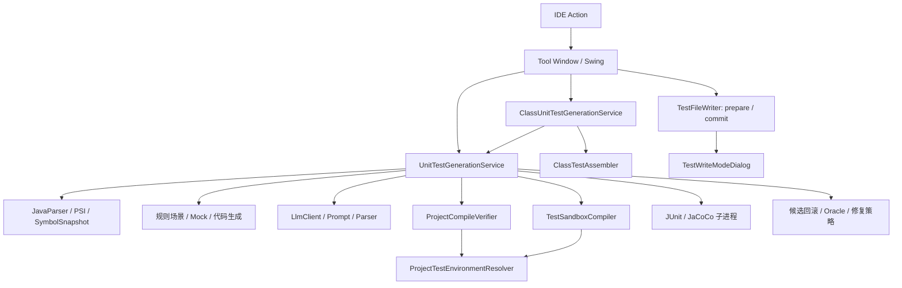
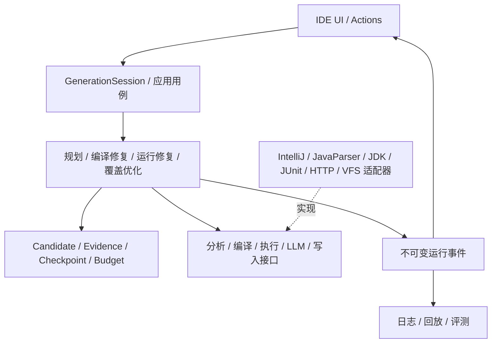

# UnitMind 架构评审

评审日期：2026-09-17。对象：当前工作区代码，包括尚未提交的修改。本文记录分析、建议及随后落地的第一批修复。

## 修复进展（2026-09-17）

本评审提出的第一批五项正确性问题已经落地：后台生成、重新校验、重新生成和最终写入均绑定启动时的文件与结果会话；写入使用源文件和目标文件快照做乐观冲突检查；Oracle 门禁保护直接传入断言的局部值来源；普通校验和运行前校验共用 `TestSandboxCompiler`；单方法 region 改用 methodId/签名区分重载。新增回归测试已纳入完整测试集，当前 263 项测试全部通过。

后续 P2 项仍是演进建议，包括进一步拆分主服务、统一模型调用取消与总预算、缩小 PSI 读锁、项目能力建模及更强的质量评测门禁。

## 结论

当前架构已经具备完整的生成与验证闭环，最有价值的资产是：静态分析与生成分离、真实项目符号上下文、整类增量聚合事务、候选回滚、运行断言门禁，以及冻结的评测语料。

下一阶段建议保持 IntelliJ 插件单体交付，在内部形成可独立测试的生成核心。优先解决会话一致性、写入一致性和验证可信度，然后收敛编译器与修复编排。继续把规则和异常分支集中添加到主服务，会使修改影响范围不断扩大。

## 评审范围与证据强度

- 统计主源码：141 个 Java 文件、27,628 行，含注释和空行；测试源码 60 个 Java 文件（不等于 60 个测试用例）。
- 重点追踪：Action → Tool Window → 方法/整类服务 → LLM → 编译 → JUnit/JaCoCo → 文件合并写入。
- 重点阅读了上述链路及模型、环境解析、Oracle 门禁、评测配置和构建依赖。
- “确认”表示从当前实现直接可见；“复现”表示额外执行了最小探针；“风险”表示存在可行触发路径，尚未进行完整 IDE 交互复现。
- 修复后已执行完整 Gradle 测试；未执行 IDE 多版本兼容验证、真实项目性能基准或付费模型评测。本文不据此断言实际延迟或最新依赖兼容性。

## 当前架构



目前主要按技术职责分包；包名清楚，但边界仍由调用习惯维护。直接 import 扫描显示 `writer → ui`、`ui → writer` 的包级循环；`generator → llm` 也使局部门禁依赖传输响应类型。模型包未直接依赖其他业务包，这是值得保留的基础。

| 热点 | 行数 | 当前承担的职责 |
|---|---:|---|
| UnitTestGenerationService | 4,406 | 分析、PSI 补全、请求构造、编译修复、整类运行修复、覆盖率、预算、诊断、回滚 |
| UnitMindToolWindowPanel | 1,262 | 页面、任务调度、可变会话、验证与写入决策 |
| JUnitMockitoTestGenerator | 1,090 | 规则代码模板及数据、Mock 分支 |
| LlmPromptBuilder | 835 | 多种操作的上下文与协议规则 |

行数用于定位变化热点，不能单独证明设计错误。主服务的问题是同时拥有多个变化原因，并且部分执行依赖直接 `new`，难以独立替换和测试。

## 应保留的设计

1. **分析与模型调用分离。** 打开面板不必等待模型，规则生成仍可独立工作。
2. **整类候选逐个提交。** `ClassUnitTestGenerationService.generateClassTest` 保留上一个已验证聚合结果，避免最后集中处理冲突。
3. **按最终文本校验再写入。** `TestFileWriter` 已阻止未经 prepare/validate 的常规写入，并比对候选哈希。
4. **区分编译、运行和覆盖率结果。** 不把“可编译”等同于“可运行”，环境问题与可修复错误已有区分。
5. **显式最佳候选与退化回滚。** `CoverageLoopPolicy.improved` 要求行与分支覆盖不退化。
6. **独立契约证据意识。** 已避免单纯用运行实际值为修改断言提供权威依据；需要强化实现边界，而非废弃这一设计。
7. **可重放评测基础。** 有固定语料、方法/整类分组、尝试记录与基线晋升机制。

## 优先级总览

P1：优先修复，涉及结果可信度、用户修改或会话正确性。P2：随后实施，改善扩展、效率和工程保障。不是线上事故分级。

| 优先级 | 问题 | 证据 | 建议落点 |
|---|---|---|---|
| P1 | 异步任务缺少统一会话身份 | 已确认保护不一致；交互竞态未复现 | GenerationSession + 不可变输入/事件 |
| P1 | 写入事务未检测目标文件冲突 | 已确认 | PreparedWrite 保存基线，提交时比较 |
| P1 | Oracle 只保护断言表达式，遗漏数据来源 | 门禁级已复现 | 保护实际值/期望值的数据依赖 |
| P1 | 编译与运行前编译的保证不一致 | 已确认路径差异 | 统一 CompilationService 与产物证明 |
| P1 | 单方法 region 用方法名标识 | 已确认标识碰撞条件 | 使用 owner + 签名的稳定目标 ID |
| P2 | 核心编排职责集中、层间依赖反转 | 已确认 | 分阶段抽取应用服务与端口 |
| P2 | 取消、预算和遥测散落各流程 | 已确认局部机制；没有统一任务上下文 | RequestContext + 全局预算 + LLM Gateway |
| P2 | PSI 读锁范围大、重复上下文准备 | 已确认调用范围；性能影响待测 | 短读锁快照 + 可失效缓存 |
| P2 | 验证环境与用户项目运行环境可能不同 | 已确认策略；具体不兼容待测 | 能力建模与运行后端策略 |
| P2 | 评测有趋势报告，缺少质量回归阻断 | 已确认评测任务行为 | 确定性回归与统计质量门禁 |

## 1. 用统一会话解决异步状态一致性

证据：[UnitMindToolWindowPanel.java](/Users/wangleping/Desktop/calt/Generate/src/main/java/com/casc/unittestagent/toolwindow/UnitMindToolWindowPanel.java:1133)。

`regenerateTestCode` 在后台读取面板字段 `currentPsiFile`、`generationResult`，回调又直接覆盖当前结果，没有绑定请求序号或会话 ID。用户在 A 文件请求重新生成后切到 B 文件，A 的迟到结果可能覆盖 B 的页面；后台真正开始时也可能读到已替换的上下文。

常规生成入口有 `analysisSequence`，覆盖率有 `coverageSequence`，说明已有防护意识。但常规生成的后台仍读取 `currentPsiFile`，且部分序号检查发生在第二次 `invokeLater` 之前；写入任务也缺少统一会话归属检查。不同入口分别修补，容易留下遗漏。

建议创建不可变 `GenerationSession`，至少包含 sessionId、目标 ID、源文件文本/哈希、文档修改版本、配置快照、取消信号。后台仅使用启动时捕获的上下文。所有 UI 事件在实际应用时检查 sessionId 和项目生命周期；结果通过快照发布，避免 UI 与工作线程共同修改同一个 `GenerationResult`。

验收：用可控制完成顺序的假 LLM 测试 A→B 切换、重新分析、关闭项目、连续重新生成；任何过期事件不得更新当前 UI 或自动提交旧任务。

## 2. 让写入成为真正的乐观并发事务

证据：[TestFileWriter.java](/Users/wangleping/Desktop/calt/Generate/src/main/java/com/casc/unittestagent/writer/TestFileWriter.java:101)、[异步最终校验入口](/Users/wangleping/Desktop/calt/Generate/src/main/java/com/casc/unittestagent/toolwindow/UnitMindToolWindowPanel.java:751)。

现有流程是读取旧测试文件并合并 → 异步编译 → 写入。`commit` 检查的是候选内容是否通过验证，没有检查原目标文件是否仍等于 prepare 时的版本。因此在编译等待期间，用户或其他工具修改目标测试文件，旧合并结果仍可能覆盖新修改。通过 `Files.readString` 读取磁盘也没有明确覆盖未保存 Document 的情形。

建议 `PreparedWrite` 保存目标 URI、存在性、原内容哈希、Document 修改版本、候选哈希及验证上下文。在写命令内先比较原目标版本；变化时重新合并并重新验证，不能直接落盘。优先通过 IDE 文档模型读取和提交文本。

验收：prepare 后修改文件、创建原本不存在的目标、修改未保存文档，均必须检测到冲突；没有冲突的正常流程保持一次提交。

## 3. 将 Oracle 保护从语法扩展到数据依赖

证据：[RuntimeOracleGate.java](/Users/wangleping/Desktop/calt/Generate/src/main/java/com/casc/unittestagent/generator/RuntimeOracleGate.java:80)。

当前 `KEEP` 比较断言、验证调用和部分控制流的 AST 指纹，这是有效的一层保护，但不能证明断言仍在检查生产行为。

本次以当前门禁源码编译并执行了最小探针：

```java
// 原始
int actual = sut.value();
assertEquals(2, actual);

// 候选：断言表达式不变，实际值已经不来自被测代码
int actual = 2;
assertEquals(2, actual);
```

结果：间接替换 actual 来源被 `validateRepair` 接受；直接把断言期望值 2 改为 1 被拒绝。这是门禁组件级复现，不代表完整生成链路必然接受所有这类候选。

建议先做可控的小范围强化：追踪断言参数引用的局部变量定义与重新赋值，保护通往被测方法的调用及关键 helper；对于无法证明安全的修改，保留失败状态并标记证据不足。不要试图用更多 Prompt 文案代替可执行校验。

同时把证据从字符串变为结构化对象，例如 Evidence(id, kind, sourceUri, sourceHash, range, targetId, claim)。目前 [ProjectSymbolSnapshotBuilder.java](/Users/wangleping/Desktop/calt/Generate/src/main/java/com/casc/unittestagent/parser/ProjectSymbolSnapshotBuilder.java:241) 按行提取包含 assert/verify 的文本；[权威引用检查](/Users/wangleping/Desktop/calt/Generate/src/main/java/com/casc/unittestagent/service/UnitTestGenerationService.java:2477) 核验类型与索引，但没有证明该证据适用于本次输入和断言。后续应保留测试方法、输入、断言位置和来源版本。

验收：直接/间接实际值替换、期望值变量改写、helper 返回常量、参数化数据源变更等反例；合法 fixture 修复继续通过。再用少量人工植入缺陷验证生成测试能否发现行为错误。

## 4. 统一编译实现和验证身份

证据：[ProjectCompileVerifier.java](/Users/wangleping/Desktop/calt/Generate/src/main/java/com/casc/unittestagent/validation/ProjectCompileVerifier.java:265)、[TestSandboxCompiler.java](/Users/wangleping/Desktop/calt/Generate/src/main/java/com/casc/unittestagent/coverage/TestSandboxCompiler.java:111)。

二者已共享 `ProjectTestEnvironmentResolver` 和源码依赖解析，这是正确收敛方向。但编译参数、诊断映射、临时源码和执行仍有两份逻辑：前者在 CompilerManager 正常返回后直接标记 PASSED；后者会检查本轮目标类与测试类产物是否存在，并在必要时调用模块 JDK 的 javac。

因此“写入门禁通过”与“运行前编译通过”的具体保证不一致。这里只确认标准差异，未复现某个项目中的误报。

建议统一成 `CompilationService.compile(CompilationRequest) -> CompilationResult`，返回诊断、产物清单、源码身份、编译环境身份。校验与运行消费同一种产物与证明；IDE 编译器和模块 javac 作为后端适配器。

当前 [ValidationResult.java](/Users/wangleping/Desktop/calt/Generate/src/main/java/com/casc/unittestagent/model/ValidationResult.java:65) 主要按测试代码哈希认定有效。建议身份组合包括测试文本、生产源码/相关依赖版本、模块、JDK、classpath、编译参数、验证器版本。覆盖率报告已有 sourceHash，应扩展并统一现有机制。

验收：多模块、未编译源码依赖、注解处理器、语言级别、JPMS 夹具，在校验路径与执行路径上得到一致诊断和产物身份；任何缓存复用必须通过失效测试。

## 5. 统一方法身份，防止重载写入冲突

证据：[写入目标构造](/Users/wangleping/Desktop/calt/Generate/src/main/java/com/casc/unittestagent/toolwindow/UnitMindToolWindowPanel.java:731)、[GenerationTarget.java](/Users/wangleping/Desktop/calt/Generate/src/main/java/com/casc/unittestagent/writer/GenerationTarget.java:15)、[region 删除](/Users/wangleping/Desktop/calt/Generate/src/main/java/com/casc/unittestagent/writer/TestClassMerger.java:409)。

分析和整类处理已有 methodId/签名，但单方法写入传入的是方法名。`foo(int)` 和 `foo(String)` 都会映射成同一个 region 标签，启用同方法 region 替换时存在相互替换条件。

建议从分析、候选、诊断归属一直到写入，统一使用声明类限定名 + 方法名 + 规范化参数类型；显示名称另存。旧 region 的迁移只有在能唯一定位方法时自动完成，歧义时保留原内容。

验收：同类重载、嵌套类同名方法、方法与整类生成交替写入。

## 6. 渐进拆分主服务并建立依赖边界

证据：[UnitTestGenerationService.java](/Users/wangleping/Desktop/calt/Generate/src/main/java/com/casc/unittestagent/service/UnitTestGenerationService.java:150)。

建议按变化原因抽取，而非按行数平均切分：

| 组件 | 职责 | 不应拥有 |
|---|---|---|
| AnalysisService | 源码分析、符号和证据快照 | HTTP、写盘、UI |
| GenerationPlanner | 场景、策略、初始候选 | IDE 对话框、进程管理 |
| CompileRepairEngine | 编译诊断驱动的候选修复 | Swing、PSI 查询细节 |
| RuntimeRepairEngine | 运行失败、Oracle、局部补丁与回滚 | 供应商请求格式 |
| CoverageOptimizer | 覆盖目标、增益与停止决策 | 编译器具体 API |
| ClassGenerationCoordinator | 方法候选顺序与聚合检查点 | 重复实现编译/运行修复 |
| WriteUseCase | 目标解析、合并、冲突检查和提交 | 弹窗构造 |

保留现有外部服务方法作 facade，先移动逻辑并建立等价测试，再逐步切换调用方。现有 `TestCodeValidator`、`LlmClientFactory` 是可沿用的接口起点。

核心策略依赖 AnalysisPort、CompilationPort、ExecutionPort、LlmGateway、TestRepository 等小接口。IntelliJ 对象、HTTP 响应和进程对象留在适配层。将 `TestWriteModeDialog` 移回 UI；用域模型表达 RepairProposal，再由 LLM 适配层转换响应。

不要为了抽象而创建通用工作流引擎。编译修复、运行修复、覆盖探索的接受条件不同，可以共享候选、检查点、预算与执行能力，同时保留各自明确的策略。

## 7. 统一取消、成本预算与运行遥测

证据：[HTTP 同步调用](/Users/wangleping/Desktop/calt/Generate/src/main/java/com/casc/unittestagent/llm/OpenAiCompatibleLlmClient.java:90)、[CoverageAttemptBudget](/Users/wangleping/Desktop/calt/Generate/src/main/java/com/casc/unittestagent/service/UnitTestGenerationService.java:2849)。

当前探索、修复、传输、格式与无变化重试有局部限制，也记录覆盖率请求计数。但取消没有贯穿 `LlmClient` 接口；同步 HTTP `Call` 没有交给会话取消机制。局部轮次上限也不等于整个整类任务的耗时和请求上限。

建议引入 `RequestContext`：runId、deadline、CancellationToken、BudgetLedger。语义轮次继续分开计数，额外统一限制实际模型请求数、总耗时、输入/输出 token；所有请求在发出前记账。供应商没有 usage 时明确标为估算。

HTTP Call 应能由取消信号终止，连接池按配置合理复用。供应商能力与参数规则从通用客户端分离，显式配置模型映射并记录实际使用模型，避免隐式名称替换影响评测可比性。

运行结果增加结构化事件：CandidateCreated、CompileCompleted、ExecutionCompleted、CandidateRejected、CheckpointAccepted。用 runId、candidateId、parentId 串起日志与评测，UI 订阅事件快照。

另一个可配置策略是“达标即停 / 预算内继续提升”。[CoverageLoopPolicy.java](/Users/wangleping/Desktop/calt/Generate/src/main/java/com/casc/unittestagent/coverage/CoverageLoopPolicy.java:17) 当前明确在达阈值后仍继续探索；这个选择有测试保护，应作为产品策略显式呈现，而非直接当 bug 改掉。

## 8. 缩小 PSI 读锁范围，按证据测量后缓存

证据：[静态分析读动作](/Users/wangleping/Desktop/calt/Generate/src/main/java/com/casc/unittestagent/service/UnitTestGenerationService.java:212)、[分析内容](/Users/wangleping/Desktop/calt/Generate/src/main/java/com/casc/unittestagent/service/UnitTestGenerationService.java:810)。

整个 `buildStaticAnalysisContext` 在读动作内执行，包括 JavaParser 解析、引用搜索和符号快照构造。虽然不在 EDT 执行，但长读动作仍可能延迟需要写锁的 IDE 操作。当前没有性能数据，不能据此量化卡顿。

建议短读动作捕获源码与位置 → 读动作外运行纯文本解析 → 分批、可取消地采集所需 PSI 符号。整类任务共享稳定的类和模块快照，针对不同方法提取差异上下文。

先记录分析、符号收集、环境解析、编译、模型和执行各阶段耗时，分方法数、源码规模和模块数看 P50/P95。再添加缓存，并以源码修改版本、模块依赖变化和配置版本失效。缓存正确性依赖前述验证身份建设。

## 9. 把项目兼容性变成能力模型

证据：[环境前置条件](/Users/wangleping/Desktop/calt/Generate/src/main/java/com/casc/unittestagent/coverage/ProjectTestEnvironmentResolver.java:89)、[运行 classpath](/Users/wangleping/Desktop/calt/Generate/src/main/java/com/casc/unittestagent/coverage/JacocoCoverageExecutor.java:300)、[目标路径推导](/Users/wangleping/Desktop/calt/Generate/src/main/java/com/casc/unittestagent/writer/TestFileWriter.java:135)。

当前环境解析无条件要求 Mockito；内置 ConsoleLauncher 优先加入运行 classpath；测试目标目录按 `/src/main/java/` 字符串推导。这些约束对标准项目实现简单，但纯 JUnit 项目、自定义 source set、定制运行器等场景可能遇到不必要的限制或环境偏差。

建议 ProjectCapabilities 明确 JUnit、Mockito/静态 Mock、语言级别、JPMS、注解处理器、测试根和运行后端能力。按候选的实际需求检查 Mockito；通过项目模型解析可写测试根。

运行后端逐步支持两种明确模式：快速隔离验证使用内置运行时；工程一致性验证使用项目运行时或构建工具配置。报告标明验证方式与环境指纹，避免把隔离执行成功解释为工程构建必定成功。

子进程已有超时、输出限额与直接进程终止，值得保留。当前工作目录通常是项目根/模块根，终止代码没有处理进程树；建议补齐后代进程清理、JVM 内存上限和可配置执行策略。独立 JVM 提供进程隔离，但不自动提供文件与网络权限隔离；需要更严格边界的场景可以在同一个 ExecutionPort 下扩展受限 worker。

## 10. 将评测变成重构和发布的可判定门禁

证据：[evaluation/README.md](/Users/wangleping/Desktop/calt/Generate/evaluation/README.md)、[评测测试任务](/Users/wangleping/Desktop/calt/Generate/src/test/java/com/casc/unittestagent/service/UnitMindRealApiEvaluationTest.java:152)。

现有评测区分基础设施失败和生成质量，质量主要作为趋势展示。建议保留这个探索用途，并增加明确的发布策略：

- 每次修改：离线确定性测试，重点覆盖会话竞态、写入冲突、方法标识、回滚和 Oracle 反例。
- 预发布：固定语料和同等预算下的多次生成，比较首次编译率、预算内运行成功率、覆盖达标率、疑似缺陷保留率、请求成本和耗时。
- 质量回归：给出最低有效样本量和允许退化范围，避免把少量随机波动当成回归；分方法/整类、难度、项目能力看结果。
- 测试有效性：增加 mutation 或人工植入缺陷的检测率；覆盖率与“运行全绿”本身不足以说明断言有用。
- 兼容性：构建配置已有 Plugin Verifier 目标；需要保存对应执行结果，声明的版本范围不能替代验证记录。

依赖整理作为后续小任务：当前主源码 import 扫描未发现 fastjson、JGit、Eclipse/JDT、commons-lang3、symbol-solver 的直接引用。先检查反射、资源和传递依赖，再逐项移除并跑打包/插件启动验证。这里不据版本号断言漏洞或不兼容。

## 建议目标形态



建议先在现有 Gradle 项目内按包建立约束。核心不再依赖 IntelliJ 后，再按需要拆 `core`、`intellij-adapter`、`execution-worker` 等构建模块；仍保持插件单体交付。

## 实施顺序与完成条件

| 阶段 | 内容 | 完成条件 |
|---|---|---|
| A：先修正确性 | 会话捕获与过期事件拒绝、写入冲突、重载 ID、Oracle 数据来源保护 | 对应确定性反例全部可重放并通过；既有用例不退化 |
| B：统一验证 | 共用编译服务、验证身份、不可变候选与检查点 | 写入与运行编译契约一致；环境变化可使旧结果失效 |
| C：拆分编排 | 抽出 Analysis/CompileRepair/RuntimeRepair/Coverage，用端口隔离 IDE | 核心策略测试不需启动 IDE；UI 不拥有修复决策 |
| D：提升效率与兼容 | 总预算、可取消 HTTP、阶段遥测、快照缓存、项目能力策略 | 用固定语料证明延迟/成本改善且质量无显著下降 |

不建议给尚无性能基线的优化承诺百分比。优先级可以根据当前用户痛点调整，但会话、写入和验证身份应先于并发扩展及缓存。

## 本次实际验证

使用本地已有依赖，将当前 Oracle 门禁及相关类型编译到临时目录，运行两个现有纯逻辑测试类：

- RuntimeOracleGateTest：7/7 通过。
- CoverageLoopPolicyTest：5/5 通过。

另外运行独立探针：`INDIRECT_ACTUAL_REPLACEMENT: ACCEPTED`；对照组 `DIRECT_ASSERTION_CHANGE: REJECTED`。这证明现有测试尚未覆盖所述数据来源缺口。

修复完成后又执行了完整 Gradle 测试，共 263 项，失败和错误均为 0。未调用远程模型，也未执行 IDE 多版本兼容验证或付费模型评测。
