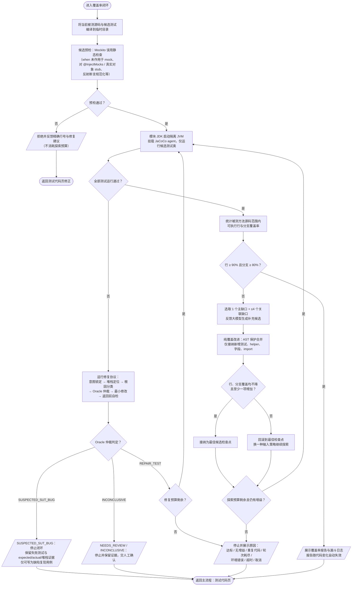

# 单元测试生成处理流程图

本文描述 UnitMind 插件"单方法单元测试生成"的完整处理流程，按照软件工程程序流程图规范绘制。

## 绘图规范说明

### 依据标准

- 符号与约定遵循 **GB/T 1526—1989《信息处理 数据流程图、程序流程图、程序网络图和系统资源图的文件编制符号及约定》**（等同于 ISO 5807:1985）。
- 采用 Mermaid 语法绘制，各图形与国标符号一一对应，可在线/IDE 预览并导出。

### 符号约定

| 图形 | Mermaid 写法 | 国标符号名称 | 含义 |
| --- | --- | --- | --- |
| 圆角框 | `([文本])` | 终端符（起止） | 流程的开始与结束 |
| 矩形 | `[文本]` | 处理 | 一个处理步骤（加工/运算） |
| 菱形 | `{文本}` | 判断 | 分支判断点，出口标注"是/否" |
| 平行四边形 | `[/文本/]` | 数据（输入/输出） | 用户输入或系统展示输出 |
| 双侧竖线矩形 | `[[文本]]` | 预定义处理 | 在别处（图 2）展开定义的模块 |
| 箭头 | `-->` | 流线 | 控制流方向 |

### 绘制规则

1. 流向自上而下、自左向右；返回路径（循环）除外。
2. 每个符号单入口；判断符号单入口、多出口，出口必须标注条件（是/否）。
3. 流线尽量避免交叉；循环回路显式回到目标判断/处理符号。
4. 采用"逐步求精"分层：主流程中将"JaCoCo 覆盖率补测闭环"画为预定义处理，在图 2 单独展开。

---

## 图 1：单元测试生成主流程

```mermaid
flowchart TD
    START(["开始"])

    IN_TRIG[/"用户在 Java 文件中将光标置于目标方法内<br/>右键选择「UnitMind：生成单元测试」"/]

    D_CTX{"项目、编辑器、PSI 文件<br/>校验通过且为 Java 文件？"}

    OUT_NOFILE[/"菜单不展示 / 提示不可用"/]
    END_NOFILE(["结束"])

    P_OPEN["打开 UnitMind Tool Window<br/>启动 Task.Backgroundable 后台分析任务"]

    P_LOC["读取源码文本<br/>PSI 定位光标所在方法"]

    D_LOC{"光标方法定位成功？"}
    P_FALLBACK["回退选取文件中<br/>public 方法或首个方法"]
    D_HAS{"存在候选方法？"}
    OUT_NOF["展示分析失败警告"]
    END_NOF(["结束"])

    P_PARSE["JavaParser 静态分析，构建 MethodModel<br/>（参数、返回值、throws、约束、分支、依赖、调用点）"]

    P_DATA["TestDataGenerator 为参数补充候选测试数据"]

    OUT_S1[/"展示静态分析结果（步骤 1）<br/>方法概要与参数约束，不调用大模型"/]

    IN_NEXT[/"用户进入「测试场景」及后续步骤<br/>按需触发第二阶段生成"/]

    P_SCEN["规则规划测试场景<br/>TestScenarioPlanner"]
    P_MOCK["规则规划 Mock 策略<br/>MockStrategyPlanner"]
    P_RULE["生成规则兜底测试代码<br/>JUnitMockitoTestGenerator"]

    D_LLM{"大模型已启用？"}

    P_PROMPT["构建项目符号快照与 Prompt<br/>（真实构造器、签名、重载、返回类型）"]
    P_CALL["后台线程调用 OpenAI 兼容接口"]
    D_OK{"生成成功且响应解析有效？"}
    D_FB{"配置允许规则兜底？"}
    P_USEFB["采用规则兜底代码<br/>记录警告"]
    P_MINFB["生成最小规则草稿<br/>提示规则兜底已禁用"]

    P_POST["测试代码后处理<br/>GeneratedTestCodePostProcessor"]

    P_COMPILE["沙箱编译校验候选测试类<br/>（模块 SDK、依赖、源码路径）"]

    D_CPASS{"编译通过？"}
    P_FIXC["编译诊断标准化后反馈大模型自动修复<br/>（默认 5 轮，可配置 0–30）"]
    D_CAGAIN{"修复轮次内且无诊断回归？"}

    OUT_S4[/"展示测试代码（步骤 4）<br/>用户可编辑、复制、再次生成"/]

    D_COV{"用户点击「运行覆盖率」？"}
    S_COV[["图 2：JaCoCo 覆盖率补测闭环"]]

    IN_MODE[/"用户在写入步骤（步骤 5）<br/>选择写入模式：新建 / 覆盖 / 追加"/]

    D_APPEND{"追加模式？"}
    P_MERGE["TestClassMerger 合并<br/>import、字段，包裹 UnitMind region<br/>同方法旧 region 可替换"]

    P_FINAL["对最终落盘文本再次编译校验<br/>（追加模式校验合并后的完整源码）"]

    D_FPASS{"校验通过？"}
    D_FORCE{"用户确认强制写入草稿？"}

    P_WRITE["TestFileWriter 经 WriteCommandAction + VFS<br/>写入 src/test/java（非标准目录写 generated-test）"]

    OUT_S5[/"展示写入结果（步骤 5）"/]

    END_OK(["结束"])

    START --> IN_TRIG --> D_CTX
    D_CTX -->|"否"| OUT_NOFILE --> END_NOFILE
    D_CTX -->|"是"| P_OPEN --> P_LOC --> D_LOC
    D_LOC -->|"否"| P_FALLBACK --> D_HAS
    D_LOC -->|"是"| P_PARSE
    D_HAS -->|"否"| OUT_NOF --> END_NOF
    D_HAS -->|"是"| P_PARSE
    P_PARSE --> P_DATA --> OUT_S1 --> IN_NEXT --> P_SCEN --> P_MOCK --> P_RULE --> D_LLM

    D_LLM -->|"是"| P_PROMPT --> P_CALL --> D_OK
    D_OK -->|"是"| P_USELLM["解析 mockStrategies / testCode / warnings<br/>标记为 LLM 生成"] --> P_POST
    D_OK -->|"否"| D_FB
    D_FB -->|"是"| P_USEFB --> P_POST
    D_FB -->|"否"| P_MINFB --> P_POST
    D_LLM -->|"否"| P_USEFB

    P_POST --> P_COMPILE --> D_CPASS
    D_CPASS -->|"是"| OUT_S4
    D_CPASS -->|"否"| P_FIXC --> D_CAGAIN
    D_CAGAIN -->|"是"| P_COMPILE
    D_CAGAIN -->|"否"| OUT_FAIL[/"展示编译失败诊断<br/>正常写入被阻止"] --> OUT_S4

    OUT_S4 --> D_COV
    D_COV -->|"是"| S_COV --> IN_MODE
    D_COV -->|"否"| IN_MODE

    IN_MODE --> D_APPEND
    D_APPEND -->|"是"| P_MERGE --> P_FINAL
    D_APPEND -->|"否"| P_FINAL

    P_FINAL --> D_FPASS
    D_FPASS -->|"是"| P_WRITE
    D_FPASS -->|"否"| D_FORCE
    D_FORCE -->|"是"| P_WRITE
    D_FORCE -->|"否"| OUT_S4
    P_WRITE --> OUT_S5 --> END_OK
```

---

## 图 2：JaCoCo 覆盖率补测闭环（图 1 预定义处理的展开）

入口条件：候选测试类已通过编译校验，用户在测试代码页点击「运行覆盖率」。



---

## 流程与代码模块对应表

| 流程环节 | 主要实现模块 |
| --- | --- |
| 右键入口与上下文校验 | `action/GenerateUnitTestMvpAction` |
| Tool Window 编排、五步骤状态 | `toolwindow/UnitMindToolWindowPanel` |
| 静态分析与 MethodModel 构建 | `service/UnitTestGenerationService.analyzeMethod`（UnitTestGenerationService.java:210）、`parser/JavaSourceAnalyzer`、`parser/ConstraintExtractor`、`parser/DependencyExtractor` |
| 候选测试数据 | `generator/TestDataGenerator` |
| 测试场景 / Mock 策略规划 | `generator/TestScenarioPlanner`、`generator/MockStrategyPlanner` |
| 规则兜底测试代码 | `generator/JUnitMockitoTestGenerator` |
| 大模型调用与响应解析 | `llm/LlmPromptBuilder`、`llm/OpenAiCompatibleLlmClient`、`llm/LlmResponseParser` |
| 编译校验与自动修复 | `coverage/TestSandboxCompiler`、`service/UnitTestGenerationService.validateAndRepair` |
| 覆盖率闭环 | `coverage/JacocoCoverageExecutor`、`coverage/CoverageCandidatePreflight`、`generator/RuntimeOracleGate` |
| 测试文件写入与合并 | `writer/TestFileWriter`、`writer/TestClassMerger` |

## 关键设计约束（图中已体现）

1. **两阶段划分**：静态分析（步骤 1）不调用大模型、不发 HTTP 请求，保证右键打开面板即时响应；进入"测试场景"及后续步骤后才允许调用大模型。
2. **可恢复**：大模型失败时按配置回退规则生成（或最小草稿），测试代码页不会空白。
3. **写入门禁**：只有最终落盘文本通过编译校验才允许正常写入；未通过时须用户明确确认"强制写入"。
4. **Oracle 保护**：运行失败修复不得将正常/成功断言改写为异常断言；疑似被测代码缺陷时停止闭环并保留证据。
5. **最佳检查点**：覆盖率补测只接纳"编译通过、全部运行成功、覆盖不降且有增益"的候选，失败时回滚。

## 导出说明

- GitHub、GitLab、IntelliJ IDEA Markdown 预览均可直接渲染上述 Mermaid 图。
- 如需插入 Word 文档：安装 [mermaid-cli](https://github.com/mermaid-js/mermaid-cli) 后执行
  `mmdc -i 单元测试生成处理流程图.md -o flowchart.svg -t neutral -b white`，
  或将预览页截图 / 使用 [mermaid.live](https://mermaid.live) 粘贴源码导出 PNG/SVG。
